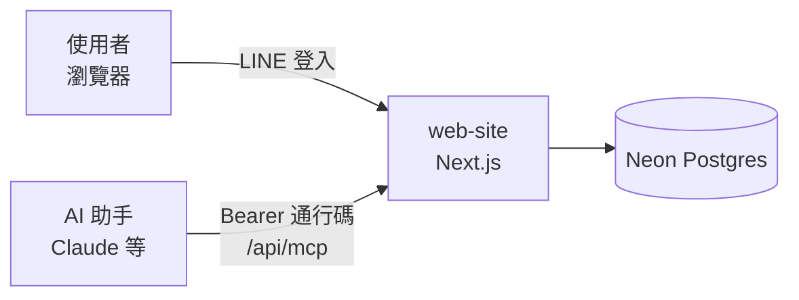

# AgentMemory

AgentMemory 是一個個人用的記憶庫。它做兩件事：

1. **存放 AI 助手要記住的事**：例如個人偏好、專案慣例、常用指令。
2. **記錄健康資料**：血壓與吃藥紀錄。

網頁給人操作。AI 助手（例如 Claude）透過 **MCP**（Model Context Protocol）讀寫同一份資料。系統只有一位使用者：用 LINE 登入，而且只有指定的 LINE 帳號可以進入。



## 功能

| 功能 | 網頁 | MCP 工具 |
|------|------|----------|
| 記憶（分類 + 名稱 + 摘要 + 內容 + 標籤） | 列表、搜尋、新增、修改、刪除 | `memory_get`、`memory_search`、`memory_save`、`memory_delete` |
| 匯入既有記憶（JSON） | 預覽後整批匯入，可選擇覆蓋同名 | — |
| 血壓紀錄 | 期間篩選、統計、趨勢圖、新增、修改、刪除 | `bp_add`、`bp_query`、`bp_summary` |
| 吃藥紀錄 | 期間與藥名篩選、新增、修改、刪除 | `med_add`、`med_query`、`med_drugs` |
| 通行碼（給 AI 用） | 產生、撤銷、查看最後使用時間 | — |

### AI 怎麼漸進取用記憶

AI 不必一次讀進全部記憶。它先讀目錄，再讀需要的那一筆：

```
memory_get { key: "index" }            → 該分類的「名稱：摘要」清單
memory_get { key: "git-commit-rule" }  → 單筆完整內容
```

目錄最後一行會提示其他資料的工具：「其他資料：血壓（bp_*）、吃藥（med_*）」。

## 專案結構

| 目錄 | 內容 |
|------|------|
| `web-site/` | 正式系統：Next.js 16 全端（網頁 + API + MCP） |
| `e2e/` | Playwright 驗收測試，受測對象是 `web-site/` |
| `demo-site/` | 早期的純前端 Demo，作為 UI 基準 |
| `.claude/skills/CodingStyle/` | 本專案的程式風格規範 |

## 技術選型

| 項目 | 選擇 |
|------|------|
| 框架 | Next.js 16（App Router）、React 19、TypeScript |
| 樣式 | Tailwind CSS v4，色彩一律取自 design tokens |
| 資料庫 | Neon Postgres，Drizzle ORM（neon-http driver） |
| 登入 | Auth.js v5（LINE），JWT session |
| MCP | `mcp-handler` + zod |
| 測試 | Playwright |
| 部署 | Vercel |

## 安全設計

- **登入門禁**：只有 `ALLOWED_LINE_USER_ID` 指定的 LINE 帳號可以登入。每次登入（包括被拒絕的）都寫進 `login_logs`。
- **通行碼**：原文只在產生時顯示一次。資料庫只存 SHA-256 指紋。通行碼可撤銷，也會到期。
- **備註加密**：血壓與吃藥的備註用 AES-256-GCM 加密後才存入資料庫。
- **API 方法**：只用 GET 與 POST，修改與刪除也用 POST。

> ⚠️ `NOTE_ENC_KEY` 遺失後，已加密的備註就無法解開。請另外備份這把金鑰。

## 本機開發

### 1. 準備

- Node.js 20 以上
- 一個 Neon 資料庫（建議開發用 dev branch）
- 一個 LINE Login channel，callback 設為 `http://localhost:3000/api/auth/callback/line`

### 2. 設定環境變數

```bash
cd web-site
cp .env.example .env.local
```

在 `.env.local` 填入下列值：

| 變數 | 說明 |
|------|------|
| `DATABASE_URL` | Neon 連線字串 |
| `AUTH_SECRET` | Auth.js 簽 session 用的密鑰（`npx auth secret` 產生） |
| `AUTH_LINE_ID` | LINE Login channel 的 **Channel ID** |
| `AUTH_LINE_SECRET` | LINE Login channel 的 Channel secret |
| `ALLOWED_LINE_USER_ID` | 唯一可登入的 LINE 帳號代號（見下方說明） |
| `NOTE_ENC_KEY` | 32 bytes 隨機值的 Base64 |
| `TOKEN_DEFAULT_DAYS`、`TOKEN_MAX_DAYS`、`WEB_SESSION_HOURS` | 選填，有預設值 |

`NOTE_ENC_KEY` 可以在 PowerShell 用下列指令產生：

```powershell
$b = New-Object byte[] 32; [Security.Cryptography.RandomNumberGenerator]::Create().GetBytes($b); [Convert]::ToBase64String($b)
```

**怎麼取得 `ALLOWED_LINE_USER_ID`**：先隨便填一個值，用自己的 LINE 帳號登入一次。登入會被拒絕，但 `login_logs` 會記下你的帳號代號，把它填回 `.env.local` 即可。

### 3. 建立資料表與測試資料

```bash
npm install
npm run db:migrate
npm run db:seed
```

`db:seed` 會寫入記憶 10 筆、血壓 42 筆、吃藥 83 筆。任一資料表已有資料時，它會直接中止，不會覆蓋。

### 4. 啟動

```bash
npm run dev
```

開啟 http://localhost:3000 ，用 LINE 登入。

### 常用指令（在 `web-site/` 下）

| 指令 | 用途 |
|------|------|
| `npm run dev` | 開發伺服器 |
| `npm run build` | 正式建置 |
| `npm run lint` | ESLint |
| `npm run db:generate` | 修改 `src/db/schema.ts` 後產生 migration |
| `npm run db:migrate` | 套用 migration |
| `npm run db:seed` | 寫入測試資料 |

## 讓 AI 助手連上 MCP

1. 登入網頁，到「通行碼」頁產生一組通行碼，複製原文（`am_` 開頭）。
2. 在 AI 助手的 MCP 設定加入下列內容。這裡用 `mcp-remote` 把 HTTP 端點橋接成本機程序：

```json
{
  "mcpServers": {
    "agentmemory": {
      "command": "npx",
      "args": [
        "mcp-remote",
        "https://<你的網域>/api/mcp",
        "--header",
        "Authorization: Bearer ${AGENTMEMORY_TOKEN}"
      ],
      "env": { "AGENTMEMORY_TOKEN": "am_..." }
    }
  }
}
```

時間參數用 ISO-8601。沒帶時區時，系統當成台北時間（+08:00）。

## 驗收測試

`e2e/` 有 20 支 spec，共 202 個案例：

| Playwright project | 內容 | 案例數 |
|--------------------|------|:------:|
| `api` | 網頁 API、MCP 工具、權限 | 126 |
| `ui` | 各頁面操作 | 57 |
| `e2e` | 跨功能的完整情境 | 19 |

測試不走真的 LINE 登入。`global-setup.ts` 用 `web-site/.env.local` 的 `AUTH_SECRET` 自己簽一個 session cookie。

執行方式：

1. 先啟動 `web-site` 的開發伺服器（http://localhost:3000）。
2. 建議先重灌測試資料：清空 `memories`、`bp_records`、`med_records` 三張表，再執行 `npm run db:seed`。
3. 執行測試：

```bash
cd e2e
npm install
npx playwright install chromium
npm test
```

| 指令 | 用途 |
|------|------|
| `npm test` | 全部測試 |
| `npm run test:api` | 只跑 API |
| `npm run test:ui` | 只跑 UI |
| `npm run test:e2e` | 只跑端到端情境 |
| `npm run report` | 開啟 HTML 報告 |

要測其他環境時，設定 `BASE_URL`，例如 `BASE_URL=https://staging.example.com npm test`。

> ⚠️ 測試會在資料庫寫入資料。只對開發或測試資料庫執行，不要對正式資料庫執行。

## 部署（Vercel）

1. 在 Vercel 匯入本 repo，Root Directory 設為 `web-site`。
2. 在 Vercel 的 Environment Variables 填入與 `.env.local` 相同的變數。正式環境請用另一組 `AUTH_SECRET`，並使用正式的 Neon branch。
3. LINE Login channel 加上正式網域的 callback：`https://<你的網域>/api/auth/callback/line`。
4. 部署前，對正式資料庫執行一次 `npm run db:migrate`。
